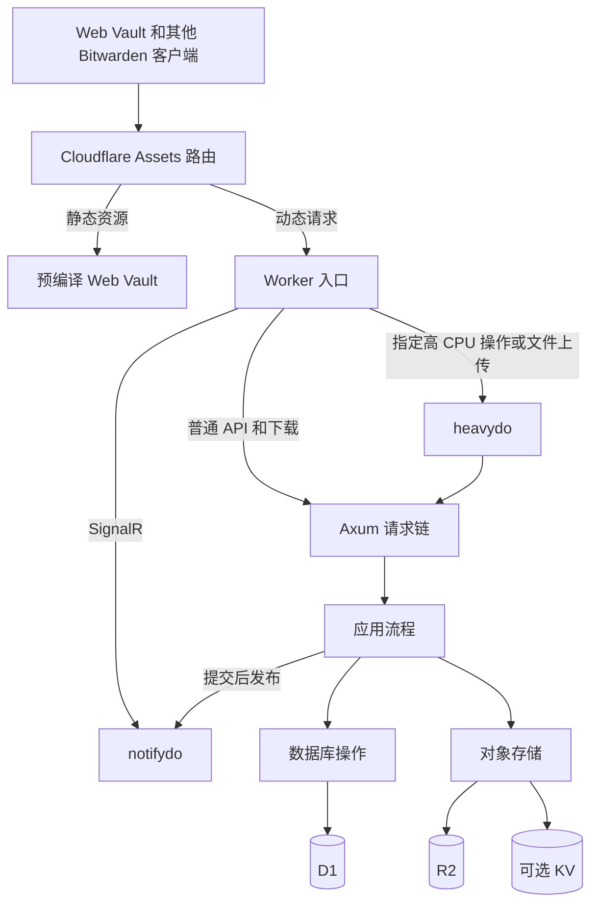

# Raywarden 架构

Raywarden 面向个人及小范围自用的独立账户。Bitwarden 客户端负责生成加密材料和加解密，Worker 保存密文、验证材料和文件元数据。部署与本地启动见[部署指南](deployment.md)，环境变量和容量限制见[运行配置](runtime-config.md)。

## 请求流向

Wrangler 使用 worker-build 生成的 `build/index.js` 加载 Rust Worker。[lib.rs](../src/lib.rs) 注册 fetch、scheduled 入口与 DO 类，[api/edge/](../src/api/edge) 规范化尾斜杠并决定请求去向。Query 和原生流式正文在转发中保留。两份 Wrangler 配置的 `run_worker_first` 决定哪些路径优先经过 Worker。

heavydo 可关闭。开启时，高成本账户操作和上传按有限分片转发，文件上传正文交由 DO 中的 API 消费。分片输入只决定实例，认证与授权仍在共享 API 链执行。notifydo 的全局实例负责 SignalR 协商、WebSocket 会话与受签名的内部扇出。

## 源码入口

| 路径 | 职责 |
| --- | --- |
| [api/bootstrap.rs](../src/api/bootstrap.rs) | 装配 Axum 路由与响应处理，为需要完整应用状态的路由加载 D1 与签名密钥 |
| [api/routers/](../src/api/routers) | 注册路径、方法、兼容别名与路由级限制 |
| [api/controller/](../src/api/controller) | 提取 HTTP 输入、调用业务逻辑和构造响应 |
| [api/middleware/](../src/api/middleware)、[api/common/](../src/api/common) | Bearer 认证提取、公共请求提取器、CORS、响应头策略、Worker 响应转换、成功响应与下载协议 |
| [errors/](../src/errors) | 应用错误类型、数据库冲突哨兵、底层错误转换及对外错误响应 |
| [infra/config.rs](../src/infra/config.rs) | 应用设置的读取、默认值与校验 |
| [api.rs](../src/api.rs) | 定义 API 请求共享的环境、配置、D1 和 JWT 签名密钥 |
| [service/](../src/service) | 输入归一化、凭据策略、业务流程、通知与响应投影 |
| [models/](../src/models) | 数据库行、查询、事务语句、持久化快照与条件写入 |
| [infra/](../src/infra) | Worker 平台适配，包括环境绑定、数据库 SDK、密码学原语、日志和对象存储 |
| [utils/](../src/utils) | 时间、严格 Serde 转换、常量时间比较和版本解析 |
| [static/overrides/](../static/overrides) | 自有 Web Vault 样式及客户端脚本，准备时复制到生成的前端目录 |

身份认证相关流程集中在 [service/identity/](../src/service/identity)，个人密码库在 [service/vault/](../src/service/vault)，Send 由 [service/send.rs](../src/service/send.rs) 及其子模块处理。各业务的 SQL 归 models，service 负责组合语句和回传结果。Axum 通过 `Arc<AppState>` 共享每次请求的资源，API 将业务函数需要的依赖传给 service。边缘接入与 DO 传输壳位于 [api/edge/](../src/api/edge)，通知会话与扇出业务位于 [service/notifications/](../src/service/notifications)，运行时导出类名为 `heavydo` 和 `notifydo`。命名和外部协议映射见[命名规范](naming-conventions.md)。

修改端点从 router 找到对应 controller，再沿调用检查 service 和 model。改变事务时同时检查原子条件、出错后的数据库状态及成功通知的时序。

## 账户与一致性

- 开户由 `/setup` 的令牌或 Cookie 授权，并检查精确邮箱白名单。Cookie 有效期十分钟，绑定当前 origin 和白名单摘要。登录使用账户凭据、二次验证和设备会话，普通 API 使用 Bearer。OAuth refresh 和 Remember Cookie 的使用条件见[运行配置](runtime-config.md)。
- 客户端 KDF 和服务端 verifier 分开管理。服务端按每个账户保存的成本验证，成功完成所需 2FA 后可以条件升级 verifier，透明升级维持原修订时间和会话信息。密码、KDF、邮箱和密钥轮换使用账户与会话条件保护凭据和密文代际。
- 写入在同一个 D1 batch 中比较会话、相关记录及约束，确保失败时回滚。Sync 从多个表读取后再次比较账户快照、账户修订和会话，阻止还在组装的响应跨越相关更新。服务端用修订日期标记写入，成功提交后才发布客户端通知。
- JWT 签名密钥由 D1 中的记录和独立的 `KEY_ENCRYPTION_KEY` 一起决定。恢复数据库时保留两者，具体见[备份与恢复](db-backup-recovery.md)。

## 文件与存储

附件与 File Send 先预留元数据，再上传正文。HTTP 入口解析 multipart 或能力请求，复用流上限、实际字节校验和事务内配额检查。写入对象先使用独立暂存 key，D1 条件提交接纳成功的指针，失败路径清理未被接纳的暂存件。待清理对象由数据库记录跟踪，存储删除失败时可重试。

R2 支持流式分块上传，下载由 [HTTP 下载适配器](../src/api/common/download.rs) 和 [Worker 响应转换](../src/api/common/response.rs) 转发原生流。HEAD 读取元数据，下载支持单范围请求和验证器。KV 使用历史的原始字节格式，限制为 25 MiB。已有记录的对象 key 兼容规则仍用于读取和清理。

公开访问 Send 使用专用限流，文件访问次数在成功签发下载能力授权时原子递增。附件、Send 响应按安全下载处理，并保持各自的凭据期限和归属检查。定时任务处理过期对象、待清理文件和域名数据刷新。

## 客户端兼容范围

- 支持 V1 和 V2 个人密码库，涵盖 Cipher、文件夹、归档、导入，附件、Send、设备会话和相关通知。V2 注册按配置显式启用，客户端必须满足[最低版本要求](runtime-config.md)。
- 当前 Web Vault 使用附件与 File Send 的两步上传。既有文件、续传或替换所用的受支持数据路由及下载流程保留。旧的一步 multipart 创建入口已移除。
- TOTP 设置使用 `/api/two-factor/get-authenticator` 和 `/api/two-factor/authenticator`，已有已启用因子继续可用。旧的 `request`、`enable`、`disable` 三个 TOTP 子路径及服务端 QR 生成已移除。
- 组织、企业共享、SSO、紧急访问和公开注册不在项目范围。兼容性空列表与界面开关只影响客户端呈现。

曾在隔离 HTTPS 环境用固定 Web Vault 2026.10.1 验证 V1/V2 开户、保存、解锁和重登解密，并验证 V2 改 KDF 或主密码后仍能解密原数据。扩展、手机、生产 D1/R2 与真实通知投递按部署环境分别验收。项目没有自动备份或恢复任务。

## 数据库与验证

[迁移目录](../sql/migrations/README.md)是运行结构来源。新库应用完整的 `0001`–`0008` 迁移链，后续从 `0009_*.sql` 起追加迁移并保留已应用文件。旧历史库需要单独的数据转移。使用 `just schema` 再生结构快照，`just test-sql` 检查 SQLite 行为和漂移。

`just ci` 检查源码与迁移，`just build` 后的 `just test-worker` 运行实际 WASM 和临时 SQLite，模拟存储和外部绑定。`just test-d1` 使用隔离的 Wrangler 和原生 D1/R2 绑定验证全新建库、重复应用迁移与文件替换清理。发布探针通过健康接口确认实际响应来自本次产物。 [部署指南](deployment.md)
