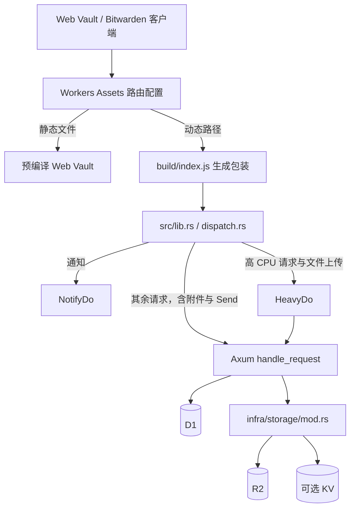

# Raywarden 架构、代码设计与优化路线

更新日期：2026-11-18。本文描述仓库当前实现；运行步骤见[部署说明](deployment.md)，参数见[运行配置表](runtime-config.md)，逐项验收见[建设计划](implementation-plan.md)。

Rust 结构整理已按[重构设计](rust-refactoring.md)完成 A、B、C 三轮：入口/状态/HTTP 响应分离，旧写入路径清理，Cipher/User 模型按职责拆分，Send 聚合为独立业务目录；2FA 的会话参数、共享邮箱 proof 与认证解析也已收敛。完整验收结果见[第三轮记录](rust-refactoring.md#10-第三轮实施记录2026-11-18)。账户和密码库的进一步聚合属于后续独立步骤。

第四轮配置能力整理将日志过滤、CORS、管理通知和客户端展示分别收敛到具名模块，补齐参考配置的真实读取和调用；实施与回归结果见[本轮设计及记录](rust-refactoring.md#11-第四轮设计配置能力与参考行为对齐2026-11-18)。组织、SSO 和紧急访问的样式开关不代表新增对应后端。

最新对照 ww1 `31359e3` 补入 V2 账户加密、密钥轮换保护、blob 与新类型密码项、attachments2、归档及导入、Send 访问计数和文件生命周期。第五轮补齐独立所有者初始化授权和数据库唯一用户约束，真实客户端验收仍单独推进；[功能对齐记录](feature-parity.md)分别列出当前实现、有意差异和历史审计。

## 1. 项目定位与当前边界

Raywarden 是部署在 Cloudflare Workers 上的 Bitwarden 兼容服务端。客户端生成密码库加密材料，服务端保存密文、账户验证材料和文件元数据。前端采用固定版本的预编译 Web Vault，不在本仓库重新构建 Bitwarden 前端。

项目采用单用户、多个设备、配置中指定唯一完整邮箱、关闭公开注册并受控初始化的约束。空库持有独立初始化授权时才能注册；数据库唯一常量索引拒绝第二行用户，包括并发开户的输家。`DISABLE_USER_REGISTRATION` 保留为展示兼容值，不能开放公开注册；邮箱配置和数据库迁移均不会自动创建账户或客户端密钥。

本仓库保留附件、Send、通知、邮件、Passkey、移动推送等已有实现。当前先验收账户与密码库主流程；组织、SSO、企业共享和紧急访问不进入建设范围。兼容性响应和已有代码仍按客户端需要保留。

## 2. 请求如何进入系统

静态资源和需要先经过 Worker 的路径由 `wrangler*.jsonc` 的 `assets` 配置决定。`run_worker_first` 是优先路由规则，不是请求白名单；未列出的普通请求仍可能回退到 Worker。Wrangler 的入口是工具生成的 `build/index.js`，手写服务端代码均为 Rust。生成包装将事件交给 [lib.rs](../src/lib.rs)；[dispatch.rs](../src/dispatch.rs) 先处理通知和选定高 CPU 请求，其余请求进入同一个 `api::handle_request`，包括附件与 Send 的上传和下载。定时事件及两个 DO 类也由 Rust 导出。

各运行部分承担不同职责：

| 部分 | 职责与边界 |
| --- | --- |
| Rust/WASM + Axum | API、身份校验、密码库与账户逻辑、完整文件路径、数据库操作、定时清理 |
| HeavyDo | 将指定高 CPU 请求交给 DO 执行，仍复用同一个 `api::handle_request`；没有另一套账户业务逻辑 |
| NotifyDo | SignalR 协商、WebSocket 连接与事件扇出；当前使用一个 `global` 实例 |
| 共享文件存储 | R2 分块上传与原生流下载、KV 有界回退；业务 token、归属、配额与状态仍由处理器检查 |

实际文件上传也在 HeavyDo 启用时使用同一套有界分流，分流前不读取或克隆上传正文；大文件下载保留在普通 Worker 的原生响应流中。这样把 Rust 分块处理的 CPU 放入既有卸载路径，不代表总 CPU 或内存成本降低。HeavyDo 的分片选择会解析未经验证的请求信息，该信息只用于选择数量受限的 DO，最终授权仍由 API 完成。附件和 Send 不再经过独立的手写 JS 鉴权或数据库实现；它们复用 Rust JWT、存储和通知模块。

## 3. 从哪里阅读和修改代码

建议按“入口 → 路由 → 对应处理函数 → 数据库/平台边界”的顺序阅读，不必先读完所有模块。

| 路径 | 维护职责 |
| --- | --- |
| [src/dispatch.rs](../src/dispatch.rs) | 通知请求转发、HeavyDo 分片选择和入口 CORS；不消费普通文件请求体 |
| [src/lib.rs](../src/lib.rs)、[src/api.rs](../src/api.rs) | Worker 事件与统一请求执行；成功响应后的变更通知 |
| [src/api/state.rs](../src/api/state.rs) | 按请求加载配置与 D1 句柄，同一请求内通过 Arc 共享，绑定错误通过 Result 传播 |
| [src/api/response.rs](../src/api/response.rs)、[src/errors.rs](../src/errors.rs) | HTTP 状态及兼容响应与核心错误类型分别维护；5xx 隐藏内部上下文 |
| [src/api/routers/](../src/api/routers) | URL、HTTP 方法与处理函数的对应关系 |
| [src/api/controller/](../src/api/controller) | 请求参数、协议兼容、鉴权调用、业务编排与响应 |
| [src/api/service/](../src/api/service) | 可复用的认证、KDF、邮件、2FA proof、通知等业务逻辑 |
| [service/ui.rs](../src/api/service/ui.rs) | 全部动态 CSS 开关、自定义样式及客户端 onboarding 设置；不决定 API 权限 |
| [service/setup.rs](../src/api/service/setup.rs)、[controller/setup.rs](../src/api/controller/setup.rs) | 所有者令牌校验、严格单邮箱与空库检查、短期 Cookie 授权，以及同源 `/setup` 页面 |
| [src/models/](../src/models) | D1 SQL、数据结构、所属用户过滤和读写操作 |
| [models/cipher/](../src/models/cipher/mod.rs) | types 定义协议与行类型，codec 负责校验和序列化，store 只保留当前生产读取与清理查询；写入由具名事务用例执行 |
| [models/user/](../src/models/user/mod.rs) | row、requests、credentials、store 分别维护账户行、请求归一化、验证和持久化；KDF 查询、账户插入和带快照比较的旧 verifier 迁移均在 store |
| [src/send/](../src/send/mod.rs) | 聚合 Send 的 HTTP、路由、协议类型、存储及用例；mod 约束域外可用接口 |
| [service/twofactor.rs](../src/api/service/twofactor.rs) | 邮箱 factor proof 的签发与验证，供邮箱和通用 2FA 处理器共用 |
| [service/auth.rs](../src/api/service/auth.rs) | token 响应及共享设备 header、客户端版本解析 |
| [src/infra/](../src/infra) | 配置、数据库 binding、密码学、JWT、文件存储及平台接口 |
| [infra/cors.rs](../src/infra/cors.rs) | 主 API、DO 分流、入口错误及预检共用来源策略；保留旧变量别名，显式无效列表拒绝跨域 |
| [infra/logging.rs](../src/infra/logging.rs) | 全局级别和 auth/api/db/external/notify 模块覆盖，真实 target/module_path 过滤 |
| [infra/admin_notify.rs](../src/infra/admin_notify.rs)、[infra/delivery.rs](../src/infra/delivery.rs) | 具名管理事件、严重级别、筛选及通道；收件人验证码邮件独立维护 |
| [controller/demo.rs](../src/api/controller/demo.rs) | 默认关闭的同源自测页、no-store/CSP；页面不进入静态产物，内部 API 仍须原有鉴权 |
| [src/durable/](../src/durable) | HeavyDo 与 NotifyDo 的 Rust 实现 |
| [sql/migrations/](../sql/migrations) | 数据库结构的唯一运行来源 |
| [sql/schema.sql](../sql/schema.sql) | 完整迁移链生成的当前应用结构快照，用于阅读和评审，不参与应用初始化或升级 |
| [static/overrides/](../static/overrides) | 自有 CSS/JS；生成的 `static/web-vault` 不纳入源码维护 |
| [Justfile](../Justfile)、[scripts/](../scripts) | 开发入口，以及确有内容解析、状态校验需求的辅助代码 |

文件路径的主要维护位置如下；`build/` 是生成的 JS/WASM 交付产物，浏览器端的 `static/overrides/` 和预编译 Web Vault 继续独立维护。

| 文件 | 职责 |
| --- | --- |
| [controller/attachments.rs](../src/api/controller/attachments.rs)、[routers/attachments.rs](../src/api/routers/attachments.rs) | 附件元数据、Azure PUT capability、direct/legacy multipart、签名 GET/HEAD、删除与完成通知 |
| [send/http.rs](../src/send/http.rs)、[send/routes.rs](../src/send/routes.rs)、[send/store.rs](../src/send/store.rs) | Send HTTP 与路由、三种文件上传、签名下载、原子访问计数与文件指针提交；行数据与协议类型在 types.rs |
| [infra/storage/mod.rs](../src/infra/storage/mod.rs) | R2 8 MiB 分块上传、错误 abort、原生下载流、KV 25 MiB 原始字节回退 |
| [infra/storage/range.rs](../src/infra/storage/range.rs) | 附件与 Send 共用的严格单范围解析；存储层结合 ETag 处理 If-Range、HEAD、206/416 |
| [service/account_keys.rs](../src/api/service/account_keys.rs)、[models/account_keys.rs](../src/models/account_keys.rs) | V1/V2 账户材料、完整密文集轮换、账户快照与随机写入标记 |
| [service/cipher_mutation.rs](../src/api/service/cipher_mutation.rs) | 同一 D1 batch 内断言会话、账户及资源快照，执行写入并推进严格递增的同步游标 |
| [infra/storage/cleanup.rs](../src/infra/storage/cleanup.rs) | 删除与替换文件的持久任务、失败上传补偿和有界重试 |
| [infra/jwt_keys.rs](../src/infra/jwt_keys.rs) | Worker 与 DO 共用的 D1 稳定签名密钥 |
| [service/notifications.rs](../src/api/service/notifications.rs) | 普通变更与文件提交后的通知编码、DO 扇出与移动推送调用 |

API 入口使用 `handle_request` 自由函数；`AppState` 持有实际状态，没有独立的无状态 service 实例。配置在每次请求中重新读取，通过 `Arc<Config>` 供路由和处理器共享；D1Database 不支持 Clone，使用必要的 Arc。`infra/db.rs` 仅提供查询错误上下文和严格行解码函数，不另设 DB 包装类型。模块导入直接标明 config、crypto、db、jwt、delivery 等来源。

模型中不再维护无消费者的旧 Cipher CRUD、归档写入及账户轮换/密码/KDF 写入。当前普通修改、归档、导入与账户轮换分别走现有 service/controller 的快照事务。原来只从 AppState 取数据库的 user service 已删除，其账户查询与插入 SQL 直接归入 `models/user/store.rs`。

Send 集中在 `src/send/{mod,http,routes,types,store,token,access,upload,mutation,rotation,cleanup}.rs`。store 提供 SQL statement 和快照 predicate/绑定参数，types 定义行数据与协议类型，域内用例负责 Claims 校验、guard、配额、提交与清理。域外仅通过 crate 内可见的五个操作使用 Send：`router`、`list_json`、`issue_access_token`、`rotation_statements`、`purge_expired_sends`；另公开轮换请求类型 `RotateSendData`，供账户轮换协议使用。内部 HTTP、token 和存储类型不再从全局 API service 或 models 路径导出。

密码项与归档的共享修改编排集中在 [service/ciphers.rs](../src/api/service/ciphers.rs)，快照 guard 和原子提交集中在 [cipher_mutation.rs](../src/api/service/cipher_mutation.rs)，附件响应投影集中在 [service/attachments.rs](../src/api/service/attachments.rs)。controller 不互相调用这些业务辅助函数。每日清理由 [service/maintenance.rs](../src/api/service/maintenance.rs) 编排，cron 从 lib 直接调用它。进一步拆解模型和按业务聚合的方案见 [Rust 重构设计](rust-refactoring.md)。

当前分层允许 controller 直接调用 model，例如同步接口；文件处理器也会直接调用 D1 模型。service 用于共享业务逻辑，无需为每个请求增加一层只转发参数的函数。改动应先找到真实执行路径，再决定是否提取公共逻辑。

## 4. 数据、认证与一致性

### 账户与会话

首次初始化与登录是两个流程。`/setup` 只接受独立的 `OWNER_SETUP_TOKEN`，通过后签发 10 分钟、绑定 DOMAIN 和唯一邮箱的 HttpOnly、SameSite=Strict Cookie，HTTPS 另带 Secure，再进入固定 Web Vault 的 `/#/signup`。Web Vault 在客户端生成验证材料与加密密钥；所有注册别名共用授权、邮箱和空库检查，成功后清除 Cookie。普通 `/api/config` 始终报告关闭注册，只有空库持有效初始化凭据时临时展示注册，响应禁止缓存。CLI 显式提交 `X-Raywarden-Setup-Token` 也受相同规则约束。

初始化凭据有独立用途，不能作为 access、refresh 或二次验证 proof 使用。`users_single_owner` 唯一索引保证所有请求竞争后最多保留一位所有者；旧多用户库迁移失败保留数据。生产 `ALLOWED_EMAILS` 和初始化令牌通过 Worker Secrets 提供；令牌移除不影响已建账户登录。修改白名单不会自动重命名、替换或删除既有用户。

`prelogin` 返回 KDF 参数；客户端派生的登录验证材料进入 identity 接口，服务端完成校验并签发会话凭据。登录会话涉及 JWT、security stamp 和设备会话信息，不能仅凭解码 JWT 内容授予权限。

TOTP 配置替换和快照删除接收 [models/device.rs](../src/models/device.rs) 中的借用 `SessionSnapshot`，仅携带用户、security stamp、设备 ID 和 session token，不依赖 API Claims，也不派生 Debug/Serialize。[Claims](../src/api/service/claims.rs) 在 API 侧检查 access 用途后构造快照；模型仍在写入 SQL 内比较实时会话及因子快照，Remember 清理与该写入保持同一事务。设备 header 和客户端版本解析由 `service/auth.rs` 共用，处理器不再为这些解析调用另一个 controller。

邮箱 factor proof 的签发与校验共用 `service/twofactor.rs`，仍绑定独立用途、邮箱状态、用户、stamp、会话与严格过期时间；TOTP 和 WebAuthn proof 保留各自用途与校验规则。WebAuthn 的密码/OTP 验证参数直接转换，不再经过 JSON 往返；通用受保护操作仍拒绝使用这些专用 proof。

登录与 profile/sync 现在共用“要求二次验证”的判断：启用、非 Remember、非内部记录（type 小于 1000）。这修复了仅启用 Email 或 WebAuthn 时 `twoFactorEnabled` 误报 false 的情况。未知旧 provider 仍按原登录流程处理，没有被跳过；恢复码清理对 TOTP、Email、WebAuthn（0/1/7）的判断保持原样。

服务端 access/refresh 签名密钥在 D1 的 `jwt_keys` 中持久化。已有记录时直接复用并忽略环境中的旧值；无记录时，空账户库可随机初始化，也可一次性导入成对且非空的旧 JWT Secret，保留原始字节。已有用户或 API Key 却缺失密钥记录时，不会持久化随机替代密钥，必须恢复原行或导入原始旧 Secret。写入竞争后重读成功记录；查询失败直接报错。普通 API、文件接口和 DO 读取同一 Rust 模块，不另设进程缓存或自动轮换。

API Key 新密文使用 `v2.` 标识，以 access 密钥按用途分离派生 AES-GCM 包装密钥，并绑定所属用户；读取仍兼容无版本前缀的旧密文，不批量改写已有记录。签名密钥必须随库保留，与客户端密码库加密密钥用途不同。完整数据库泄露也会暴露服务端签名密钥，这是简化配置的取舍。

V1/V2 加密材料统一由账户模型校验和输出。V2 包含签名公钥、签名密钥对、安全状态与升级桥接材料；profile、sync 与登录响应复用同一映射。登录成功后才检查客户端版本，V2 普通客户端最低 `2026.10.1`、桌面端最低 `2026.10.2`。V2 不允许降级，也不能在轮换时替换账户公钥身份。注册不会因 schema 迁移而自动升级到 V2。

密钥轮换核对账户、全部 Cipher/Folder/附件/Send/PRF 材料快照，在一次 D1 batch 中领取随机写入标记，再门控各条更新。普通凭据变更和 PRF/设备审批也约束所读到账户代际，避免安全戳未变化时混入旧包装密钥。Ray 保留严格的设备 nonce 与 security stamp 校验，普通轮换不引入旧 access token 的宽限期；升级专用行为单独处理。没有提交 encryptedByKeyId 的旧客户端仍被兼容，不能据此识别它在请求开始前是否已经同步新密钥。

### 密码库与同步

D1 保存用户、文件夹、Cipher 密文及相关元数据。读写操作需要同时约束资源与所属用户；单用户部署也应保留这些检查。同步接口直接逐行读取 Cipher 并一次关联附件 JSON，避免整库聚合的单值上限；统一规范化类型 1–8、blob 与历史缺失字段。创建、编辑、批量修改及导入把账户/会话/资源快照断言与写入放入同一事务，普通更新的 attachments2 与 Cipher 同时提交。

数据库提交与通知不是一个事务。当前提交后发送资源级事件，批量操作发送同步事件；通知尽力送达，失败主要记录日志，手动同步仍需作为恢复路径。凭据撤销的内部通知先向已认证且身份匹配的旧连接发 LogOut，再关闭连接；V2 轮换带 Reason=1。尚未完成真实双端通知与重连验收，不假定通知已经提供可靠消息投递。

管理 Webhook 与客户端同步通知分开维护。`infra/admin_notify.rs` 用具名事件统一24个参考事件、严重级别和旧事件名兼容；handler/用例在真实成功后发布，generic Mutation 只保留客户端同步职责，避免同一操作重复发管理通知。消息仅包含事件名、等级和账户 ID，不含密码、验证码、token、邮箱或密文；正常2FA挑战、限流及数据库故障不伪装成错误密码。按收件人发送验证码的邮件不受管理事件筛选影响。

全局等价域名由运行时从 Vaultwarden 的公开分组获取，存入现有 `global_equivalent_domains` 表。`global_domains_cache` 的单行期限限制刷新频率；首次查询或已有 cron 可触发更新。先完整校验上游数据，再用 D1 batch 原子替换；成功缓存 24 小时，失败保留旧数据并在 1 小时后允许重试。用户自定义分组和排除项仍保存在用户记录里，未联网的新库只缺预置全局分组。

### 文件与清理

附件和 File Send 的字节在 R2 或可选 KV 中，D1 保存元数据和状态。R2 优先，KV 回退限制为 25 MiB。附件 V2 与 File Send 使用待完成元数据，legacy 附件在传输后直接提交完成记录；各路径分别校验配额、能力凭据、资源归属与状态。Send 上传另检查设备会话与 security stamp；附件 capability 的授权仍基于用户、资源 ID 与过期时间，附带的 device 用作通知 context，不重查当前设备会话，其撤销语义仍需收敛。过期、未完成或删除数据由相应清理路径处理。

所有上传路径逐块读取文件，R2 每部分为 8 MiB，KV 只在 25 MiB 上限内缓冲；multipart 文本元数据另设限长。每次尝试写入独立随机对象 key，完成后由 D1 快照条件提交 storage_key 指针；已完成附件只允许持有有效会话的 multipart 请求替换，Azure 能力仍只完成 pending 预留，下载 token 不能借此改写文件。并发输家只处理自己的暂存对象，替换失败保留旧文件。数据库返回不确定时，先检查暂存对象是否已被采用；检查失败保留字节。

`storage_cleanup_jobs` 没有账户外键，附件/Send 删除或替换通过数据库触发器原子登记旧对象，账户级联删除也不会丢任务。提交后和每日 cron 最多处理 128 项，存储删除成功后仅确认相同随机 generation 的任务；失败保留重试。这仍不是 D1/R2 跨系统事务，安全前提是暂存 key 不复用。

附件列表和 sync 使用不带 token 的稳定 URL，已授权元数据接口单独签发默认 60 秒的下载能力。Send 领取访问 token 不计次数；真实文本读取或有效文件授权才在事务中检查并递增次数，查看文件元数据、错误 file ID 不扣次。原有下载能力的禁用/过期/轮换撤销检查继续保留。

R2 下载通过响应扩展 `NativeStream` 将原始 `ReadableStream` 带到 `into_worker_response`，在最终 Worker 边界套用状态和响应头，不让文件每个块往返 WASM。普通 JSON 响应仍走正常转换；HEAD 不读取 R2 对象体，KV 读取仍受后端容量限制。

Rust 的 `LOG_LEVEL` 在 Worker、定时事件和 DO 首次初始化时生效，默认 info；可用 `info,auth=debug,db=warn,external=debug,notify=warn` 覆盖模块，`api` 也可独立设置。过滤按实际 Rust target/module_path 分类，全局 off 时仍能单独打开一个模块，不需逐条替换日志宏。登录等敏感操作和 Send 密码尝试分别选择两个限流 binding，复用同一个平台调用实现；后者保持现有 Send ID＋IP key。

`CORS_ALLOWED_ORIGINS` 与旧 `ALLOWED_ORIGINS` 共用 `CorsPolicy`，新名称存在时优先。空值或星号允许任意来源，显式列表无效时拒绝跨域，普通 API、DO 分流和入口错误采用同一策略；跨源响应不启用 cookie credentials。账户初始化 Cookie 仅走同源流程，密码库请求仍由 bearer 或各自能力凭据授权。原来只转发 CORS 构造的 middleware 文件已删除。

客户端展示集中在 `service/ui.rs`：全部 `VW_CSS_*`、自定义样式加载和 `CLIENT_SUPPRESS_ONBOARDING` 有真实消费者；CSS 输出决定 ETag，支持条件 GET 与 HEAD。onboarding 的 `suppressOnboardingInterstitials` 独立于 `disableUserRegistration`。`DEMO_PAGE_ENABLED` 默认 false，仅 Rust 可以提供 demo 页面；前端准备会移除静态副本，避免绕过开关。demo 只支持其明确声明的 PBKDF2 V1 流程，不代替完整客户端。

## 5. 数据库与运行方式

`sql/migrations/` 是数据库初始化、启动和后续升级的唯一运行来源。`0001_accounts.sql` 定义账户，`0002_vault.sql` 定义密码库、附件和等价域名，`0003_authentication.sql` 定义设备与认证，`0004_verification.sql` 定义验证码，`0005_sends.sql` 定义 Send。其后 `0006` 增加 JWT 密钥，`0007` 增加域名刷新状态，`0008` 增加 V2 账户与代际快照，`0009` 增加文件指针和清理任务，`0010` 增加唯一用户约束；后续从 `0011+` 追加。

`sql/schema.sql` 是由完整迁移链再生的当前应用结构快照。`just schema` 用 Python 3 在内存 SQLite 中顺序应用所有迁移并导出纯应用 DDL；修改迁移后执行它，再用 `just test-sql` 检查漂移。快照便于读表、索引和约束、评审迁移结果，也可用于临时 SQLite 结构分析；不含业务数据、种子或执行历史，不能作为应用建库/升级脚本或完整备份。它不构成第二套运行路径。

时间直接使用 Jiff 1 的 `Timestamp` 和 `SignedDuration`，由 [infra/time.rs](../src/infra/time.rs) 集中规范字符串精度。服务端新写的时间统一为 UTC、固定三位毫秒和 `Z`，如 `2026-11-17T01:02:03.123Z`；需要微秒的 API 字段使用固定六位。已有数据库时间不批量改写，到期与清理 SQL 用 `julianday` 按时间点比较，兼容旧 `+00:00`、正负偏移和不同小数精度，保留原有边界语义。对列使用时间函数可能降低已有日期索引的利用率，当前接受这一取舍。

新库顺序执行全部十个文件；后续增量可以 ALTER 表或迁移必要的既有数据。建表直接 `CREATE TABLE`，不依靠 `IF NOT EXISTS` 跳过既有对象；同一基线重复运行时由 Wrangler 的 `d1_migrations` 历史跳过已执行文件，迁移本身不预填历史。同一五文件基线后的库只应用尚未执行的追加迁移；更早的旧历史库没有自动转换路径。唯一用户索引对历史多用户库报错停止，不会删除账户。未清库、修改用户本地库或操作线上资源。

日常只需要记住这些入口：

| 目的 | 命令 |
| --- | --- |
| 首次准备工具与依赖 | `just setup` |
| 下载固定版本前端 | `just ui-download` |
| 本地启动，先应用本地迁移 | `just dev` |
| 仅应用本地迁移 | `just db-migrate` |
| 修改迁移后再生结构快照 | `just schema` |
| 检查结构快照与迁移链一致 | `just test-sql` |
| 执行源码与单元检查 | `just ci` |
| 构建后验证真实 WASM 请求链 | `just test-worker` |
| 本地生成生产交付产物，不上传 | `just dry-run` |

初始化和升级统一使用 `db-migrate`，不再另设 `db-init`。远程数据库仅由显式 `just db-migrate production` 或生产部署流程操作。本地固定 `wrangler.local.jsonc` 和 `.wrangler/local`；该配置以 `dev.local_protocol=https` 提供 HTTPS，DOMAIN 同为 `https://localhost:8787`，满足固定 Web Vault 的安全 URL 要求；所有远程命令固定 `wrangler.jsonc` 顶层生产配置，未完成的远程 dev 及其选择项已经移除。

## 6. 构建与交付

Rust 工具链、组件和 WASM target 由 `rust-toolchain.toml` 声明；依赖版本由原生锁文件约束。`just build` 调用固定版本 worker-build，Wrangler 的自定义构建也复用这个入口。

三个工作流保留原有文件，职责固定：

| 工作流 | 职责 |
| --- | --- |
| Integration | 检查、构建、准备前端、生成最终 bundle 和产物清单 |
| Coverage | 单独生成 Rust 覆盖率 |
| Cloudflare | 选择可信 Integration 运行，校验并部署已有产物；部署环境无需 Rust 构建 |

发布内容是最终 Worker bundle、前端资产、锁文件及清单。部署代码验证来源 commit、目标配置和文件摘要，移除自定义构建后使用 `--no-bundle` 上传；数据库迁移先于依赖新结构的 Worker 上线。具体部署顺序及资源身份检查见[部署说明](deployment.md)。

生产默认使用 workers.dev：部署工具查询账户子域名，与配置中的 Worker 名组合成公开 URL；显式配置唯一 custom-domain 路由时优先使用它。同一个 URL 用于健康检查与运行时 `DOMAIN` Secret。首次部署通过临时限权的 `--secrets-file` 随代码写入 DOMAIN、ALLOWED_EMAILS 和 OWNER_SETUP_TOKEN，避开“Worker 尚不存在却需提前设置 Secret”的循环；后两项后续未显式提供时继承已有 Secret。文件成功失败均清理，凭据不进入产物或命令参数。

## 7. 本轮简化与验证边界

运行入口统一到原生迁移，`schema.sql` 是可再生的结构参考。本轮将 JWT 和全局等价域名初始化收回运行时，删除 `init-env.mjs`、域名种子生成器及相关 Justfile 命令，基础运行不再需要 `.dev.vars`。脚本只保留部署配置/产物和前端准备职责。备份说明也已更新，项目当前没有自动备份工作流。

原来的 8 个手写 Worker JS 文件已迁入现有 Rust 入口、文件处理器及共享模块，不再保留双语言运行路径。生成的 JS 包装、部署/前端准备脚本和浏览器前端资源仍然存在。迁移后的测试、WASM 检查和真实产物验证结果统一记录在[执行记录](implementation-plan.md#8-执行记录)，不沿用迁移前的计数作为本轮通过证据。

此前用户终端有 Worker 启动与四项 HTTP 检查证据：alive/config/prelogin 为 200，未鉴权 sync 为 401，当时数据库有 14 条迁移记录、账户数为 0。这些历史结果不能证明新链已在 host 运行。旧持久化没有自动转换或清空，当前结构为 10 份迁移、19 表、38 个显式 DDL 对象。

编译、SQL 和 Node 测试各自证明对应边界。本轮已在临时HTTPS环境用真实固定Web Vault验证初始化、登录、密码项保存、刷新解锁及退出重登后的解密；先前仅HTTP烟测未发现客户端拒绝HTTP API的问题，现已统一本地HTTPS。扩展双端、DO/R2云端联调、邮件与推送、完整恢复、远程工作流及线上部署仍需独立取证。最新结果见[第五轮实施记录](rust-refactoring.md#14-第五轮实施记录2026-11-18)。

## 8. 后续优化顺序

每张卡只完成一个边界内的改动和验证，预算均不超过 30 分钟；若超出就继续拆卡。已有代码优先修正和验收，先不增加 ORM、通用仓储层、插件系统或消息框架。

| 优先级 | 任务卡与预算 | 验收目标 |
| --- | --- | --- |
| P1 | 服务端 verifier 成本升级设计，25 分钟 | D05：为旧行确定 100,000 次兼容语义，再设计逐账户成本记录；不直接修改固定验证常量 |
| P1 | 未知邮箱 KDF 策略，25 分钟 | D09：只改无账户时的回退，保留真实账户参数、归一化与数据库错误传播 |
| P1 | Cipher 并发真实客户端验收，25 分钟 | 事务快照保护已实现；验证两个实际设备编辑旧版本时收到冲突并能同步重试 |
| P1 | 指定客户端登录，25 分钟 | 固定 Web Vault 版本完成初始化、登录并正确解密；修复另开卡 |
| P1 | 密码项与同步验收，25 分钟 | 同一客户端完成新增、修改、文件夹与重新同步，校验密文可解密 |
| P1 | 第二设备与会话验收，25 分钟 | 一个扩展同步同一账户；刷新、撤销与重新登录结果明确 |
| P2 | TOTP 与 proof 客户端验收，25 分钟 | 原子 step 消费、配置快照和受用途/会话/状态约束的 proof 已实现；验证实际设置与停用流程 |
| P2 | 邮件注册与改邮箱验收，25 分钟 | 验证实际按收件人投递、email_verified 入库和并发凭据变化时拒绝旧请求 |
| P2 | 文件权限契约，25 分钟 | 附件与 Send 对过期、撤销、资源归属及 capability 范围给出明确、经过测试的结果 |
| P2 | 文件状态与配额契约，25 分钟 | 失败、重复上传和并发提交不泄漏预留配额，不重复完成文件 |
| P2 | 双端通知与重连，25 分钟 | 取证真实通知、重连和手动同步；依据失败情况决定是否调整投递方式 |
| P2 | 隔离恢复演练，25 分钟 | 使用准备好的测试备份核对 D1、对象文件和迁移历史；备份制作另开卡 |

[Rust 重构设计 B01–B06](rust-refactoring.md#8-第二轮实施记录2026-11-18)及[C01–C06](rust-refactoring.md#10-第三轮实施记录2026-11-18)均已完成。SQL 回归的生产源码定位集中在 [tests/sql_source.py](../tests/sql_source.py)，函数缺失、同名歧义或查询前缀歧义都会明确失败。后续账户与密码库的目录聚合，应在单用户受控初始化和指定客户端闭环验收之后，按实际维护需要推进，不作为功能建设的前置条件。
